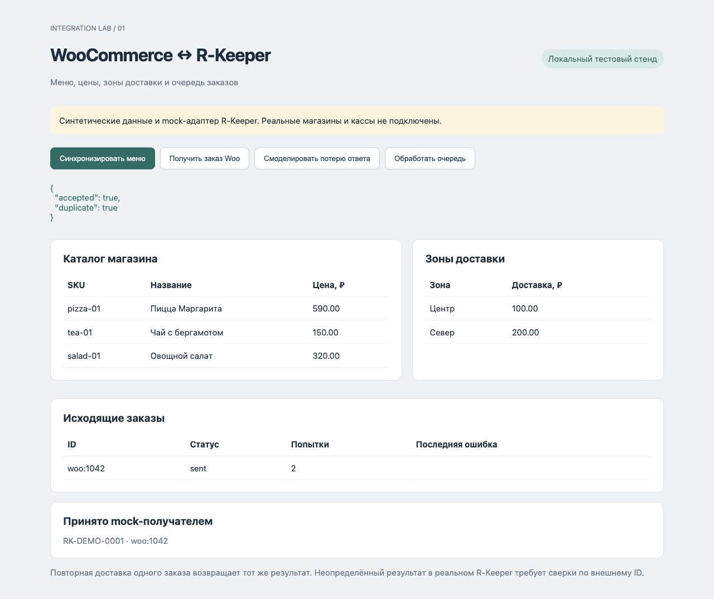

# WooCommerce и R-Keeper — стенд синхронизации

Самостоятельный тестовый проект для демонстрации меню, цен, зон доставки и устойчивой передачи заказов. Данные вымышлены. **R-Keeper и WooCommerce заменены локальными моделями; подключение к действующей кассе не выполнялось.**



## Запуск

Нужен Python 3.9+, внешних зависимостей нет.

```sh
python3 -m unittest -v
python3 server.py
```

Откройте http://127.0.0.1:8781. Windows: вместо `python3` можно использовать `py`.

1. Нажмите «Синхронизировать меню»: появятся товары, цены и две зоны.
2. «Получить заказ Woo» создаёт подписанное событие для заказа 1042.
3. «Смоделировать потерю ответа»: mock-получатель принял заказ, но очередь не получила подтверждения.
4. «Обработать очередь»: заказ получает статус sent, у получателя остаётся один заказ.
5. Снова «Получить заказ Woo»: дубль не создаёт новую запись.

SQLite сохраняет очередь после перезапуска. Для чистого запуска используйте другой путь `DEMO_DB`, например `DEMO_DB=/tmp/woo-test.sqlite python3 server.py`. Не используйте реальные персональные данные.

## Что реализовано

- Атомарный полный снимок меню, upsert по SKU, обновление цены и деактивация исчезнувших товаров.
- Снимок зон доставки с тарифами. Географические полигоны и привязка к адресу не реализованы.
- Входной `POST /webhooks/woocommerce`: проверка Base64 HMAC-SHA256 исходного тела, delivery ID, количества, SKU, валюты, зоны и суммы.
- Событие и задание сохраняются одной транзакцией. Изменение уже принятого заказа отклоняется для ручной сверки.
- Долговечная очередь, до трёх ручных попыток и отдельное состояние manual.
- Mock-получатель с уникальным external_id. Проверка потери подтверждения и повторной отправки после рестарта.
- Локальная панель с каталогом, зонами, ошибками и квитанциями.

## Границы и следующий этап

`mock_snapshot.json` — **нормализованный демонстрационный формат**, а не формат r_keeper API. `mock_orders` — симулятор приёмника в SQLite. Веб-интерфейс не делает запросов к кассе/магазину и не является установленным WooCommerce-плагином.

Для настоящего проекта нужны версия и конфигурация r_keeper, доступный XML/REST/Delivery-интерфейс и лицензии, схема меню/модификаторов, виды цен, налоги, правила доставки и тестовый WooCommerce. После уточнения выбирается драйвер. Ресторанные меню, цены и зоны не обязательно доступны через один API.

План драйвера: читать каталог и зоны через согласованный интерфейс r_keeper; сопоставлять стабильные идентификаторы с WooCommerce `/wp-json/wc/v3/products`; принимать подписанные order.created/order.updated; перед созданием заказа проверять external_id. Если приёмник не поддерживает идемпотентность или поиск по external_id, после неопределённого таймаута требуется ручная сверка, **автоматический повтор создания небезопасен**. Exactly-once для настоящей кассы не заявляется.

В демонстрации цены сверяются с текущим каталогом; скидки, модификаторы, возвраты, отмены, оплата, остатки и фискализация требуют отдельной модели. Нет фонового планировщика, многопроцессных воркеров или публичной авторизации. Сервер привязан к loopback; для production нужны HTTPS, управление секретами, изоляция, мониторинг и согласованные сценарии отказов.

## Проверка

10 автоматических тестов: обновление цен, деактивация, откат невалидного снимка, подпись, повторы, конфликт изменений, неверные позиции/сумма, потеря ACK с перезапуском, лимит попыток, количество. Результаты и исходный код тестов находятся в репозитории. Реальные R-Keeper/WooCommerce не тестировались.

## Документация

- [WooCommerce REST API](https://developer.woocommerce.com/docs/apis/rest-api/)
- [Webhook signature and delivery headers](https://developer.woocommerce.com/docs/apis/rest-api/v3/webhooks/)
- [r_keeper 7 XML interface](https://docs.restera.com/translate/r_keeper-7-xml-interface-105349121.html)

Проверено по документации 26 октября 2026. Технические возможности r_keeper необходимо подтвердить для установленной версии.
